# Lany Avatar

为同一个 Lany 小生制作不同风格的上半身头像，也支持对现有头像局部精修。调用名为 `$lany-avatar`。

当前默认：**自然手绘、正方形头肩至胸口、单张交付**。不主动继续旧全身、三视图或动作包；墨镜、耳机、卫衣和电脑都不是固定身份。像素仅在明确选择时使用。

## 快速使用

```text
使用 $lany-avatar，保留小生身份，生成一张自然手绘上半身头像，灰绿休闲外套，不戴墨镜和耳机。
使用 $lany-avatar，风格 storybook-3d，做一张温暖动画 3D 上半身头像，不画全身、不拿电脑。
使用 $lany-avatar，分别生成自然手绘、赛璐璐、温暖动画 3D、简洁 3D 四张独立上半身头像。
使用 $lany-avatar，只更新 README 和风格说明，不生图、不更换默认身份参考。
```

精修时附上目标图，写清“保持什么、只改什么”。风格名称、编号与 ID 均可使用；一张参考不等于一张输出，明确多版时才增加数量。

## 原有风格画廊（完整保留）

以下保留原来的十种风格图文与调用示例；四张新头像在本节后另行追加，不替换原图或原编号。原样例中的全身、玩偶或手势只展示已有版本，不代表本轮继续生成这些支线。

### 01 · 像素（pixel）

延续现有账号辨识度。**原像素版本，兼容保留**；背景：满版主题黄绿。

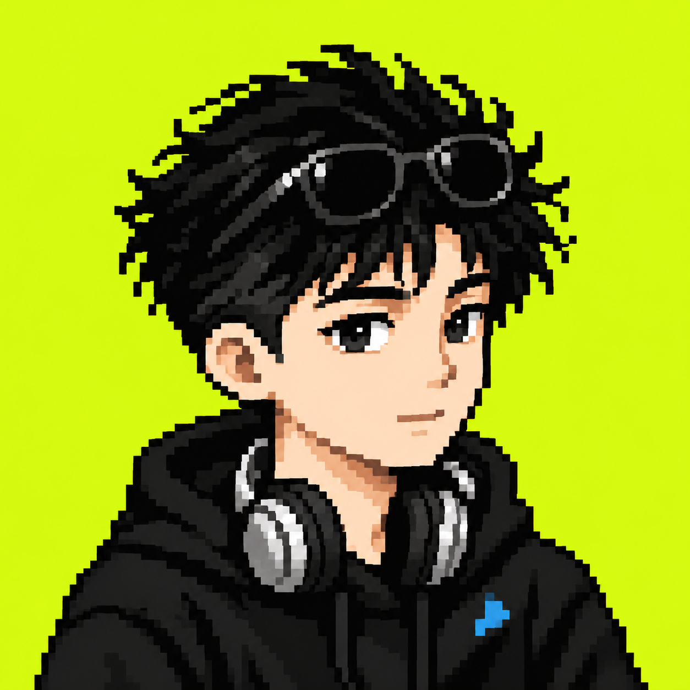

```text
使用 $lany-avatar，风格 pixel，保留当前角色和主题色，精修镜框、耳机与发束，只生成一张头像。
```

[精细像素补充试样](assets/styles/pixel-fine.png)。此补充图仍是同一风格下的候选，不另算一种身份。

### 02 · 自然手绘（soft-handdrawn）

自然、柔和的手绘个人形象。**原自然手绘身份参考，当前默认媒介**；背景：满版雾蓝灰。

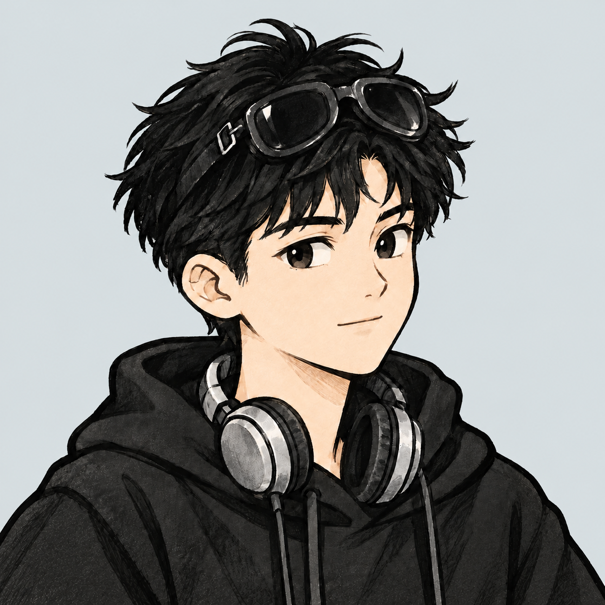

```text
使用 $lany-avatar，风格 soft-handdrawn，自然墨线、雾蓝灰满版背景，不加腮红，只生成一张头像。
```

### 03 · 赛璐璐动漫（cel-anime）

清晰的动漫线条和色块。**风格试样，待确认**；背景：满版主题黄绿。

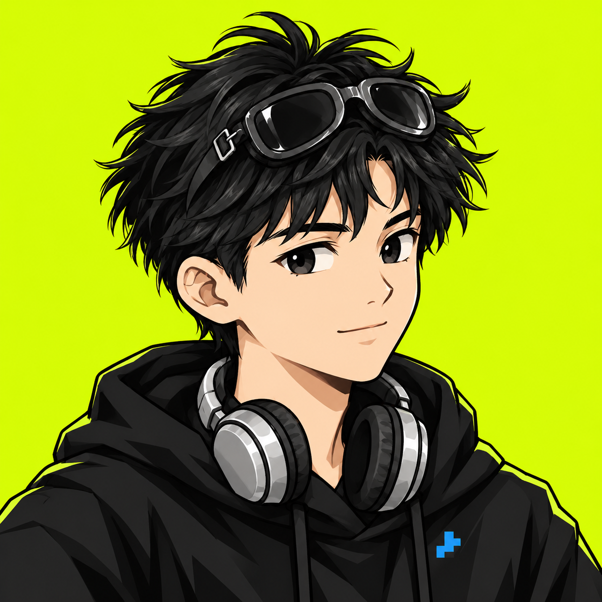

```text
使用 $lany-avatar，风格 cel-anime，清楚线条和两级色块阴影，自然闭口浅笑，只生成一张头像。
```

### 04 · 3D 潮玩质感（designer-vinyl）

立体材质、树脂收藏角色的展示。**风格试样，待确认**；背景：满版主题黄绿。

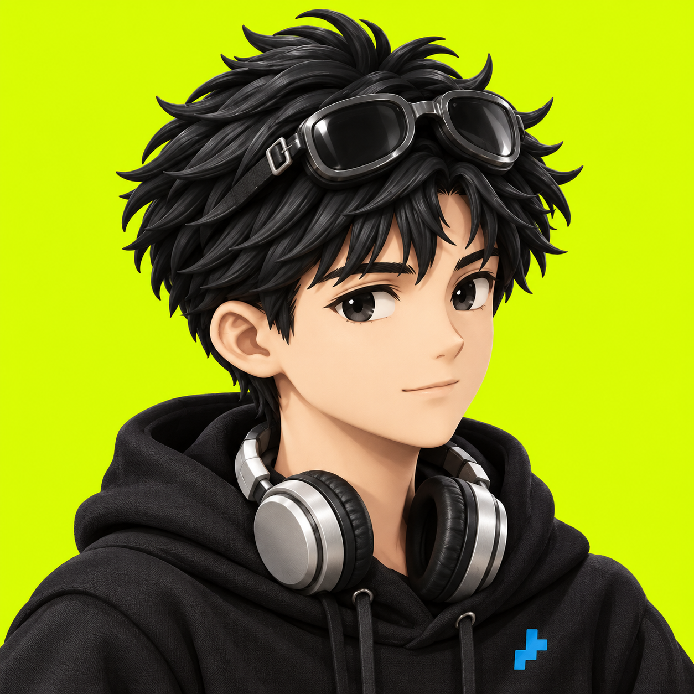

```text
使用 $lany-avatar，风格 designer-vinyl，正常少年比例、柔和哑光三维材质，只生成一张头像。
```

### 05 · 丝网印刷（screenprint）

有印刷颗粒与强图形感的形象。**风格试样，待确认**；背景：满版主题黄绿。

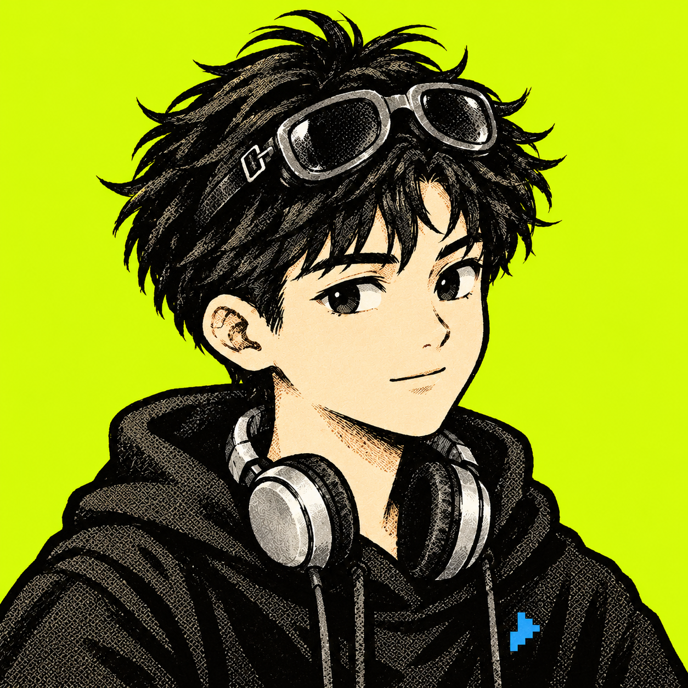

```text
使用 $lany-avatar，风格 screenprint，黑色块面、克制印刷颗粒，不放文字，只生成一张头像。
```

### 06 · 温暖动画 3D / Q版（storybook-3d）

故事感角色、活泼动作与 Q版延展。**头像与全身均为待确认试样**；背景：满版主题黄绿。

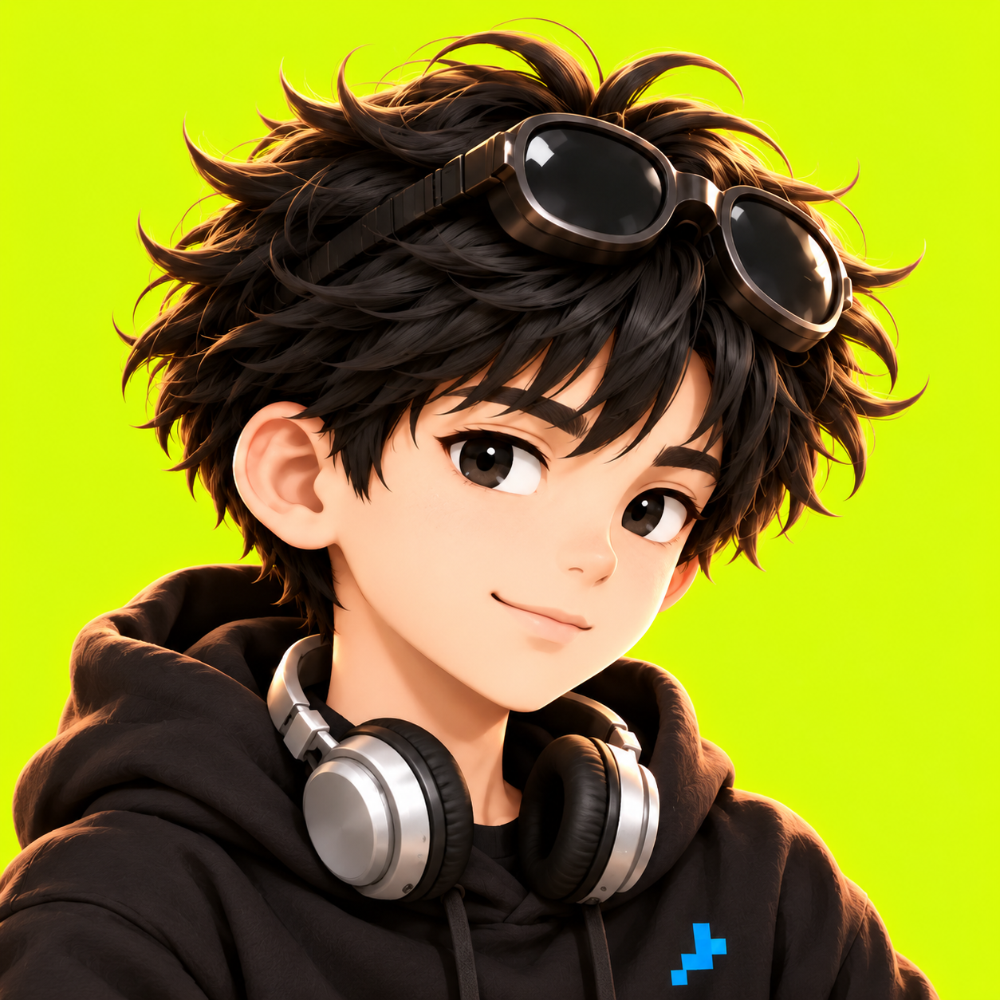

```text
使用 $lany-avatar，风格 storybook-3d，生成一个约三头身的全身小生，轻扶护目镜，肤色中性，不加腮红。
```

[全身 Q版试样（肤色修订版）](assets/styles/storybook-3d-character.png)。此补充图仍是同一风格下的候选，不另算一种身份。

### 07 · 简洁 3D 表情头像（emoji-3d）

聊天表情感、简洁亲和的三维头像。**挥手修订版，待确认**；背景：满版主题黄绿。

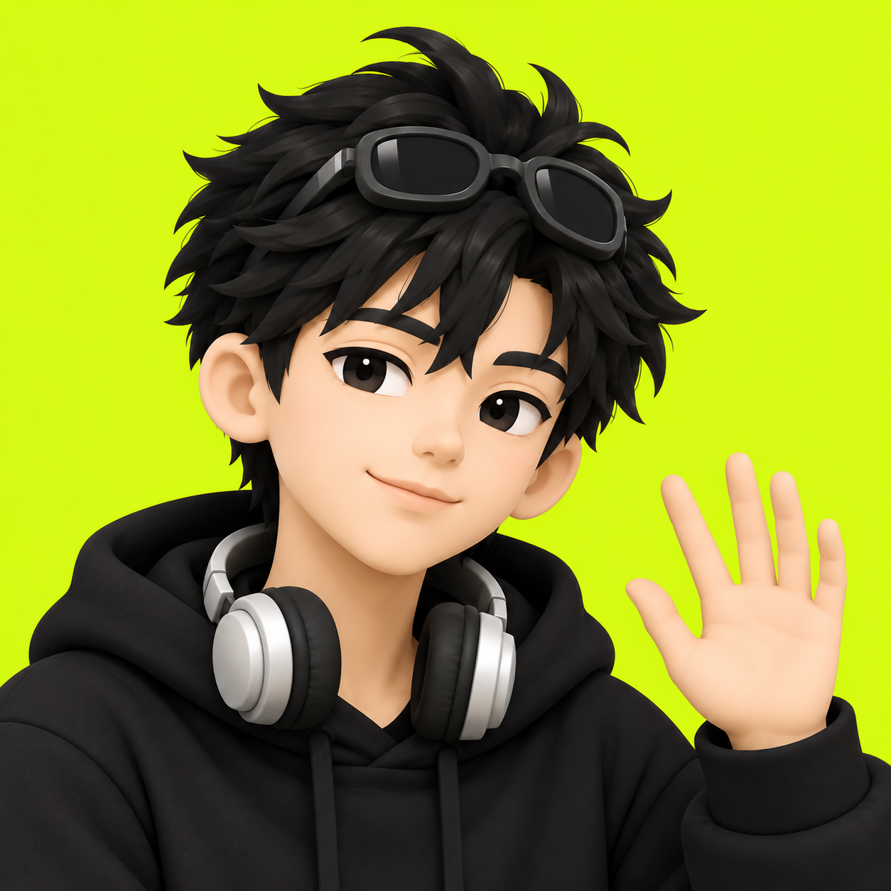

```text
使用 $lany-avatar，风格 emoji-3d，睁眼、轻微侧头、自然挥手，收简发束和配饰，只生成一张头像。
```

### 08 · 虚构人物写真风（photo-style）

观察现有角色真人化后的摄影观感。**虚构角色演绎，非本人照片**；背景：满版主题黄绿。

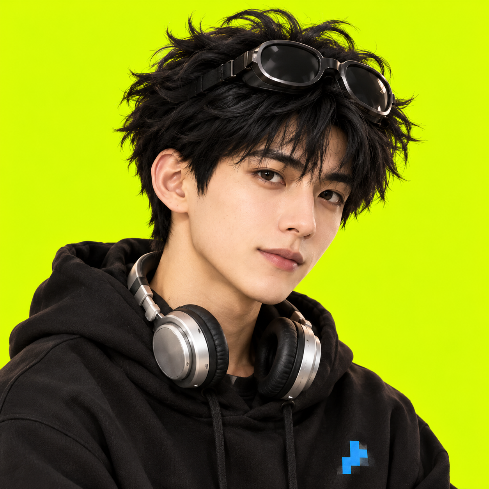

```text
使用 $lany-avatar，风格 photo-style，把当前虚构小生演绎为成年青年写真风肖像，不当作本人真实照片。
```

### 09 · 毛绒玩偶（plush）

毛绒工艺观感与角色衍生。**玩偶视觉概念，未打样**；背景：满版主题黄绿。

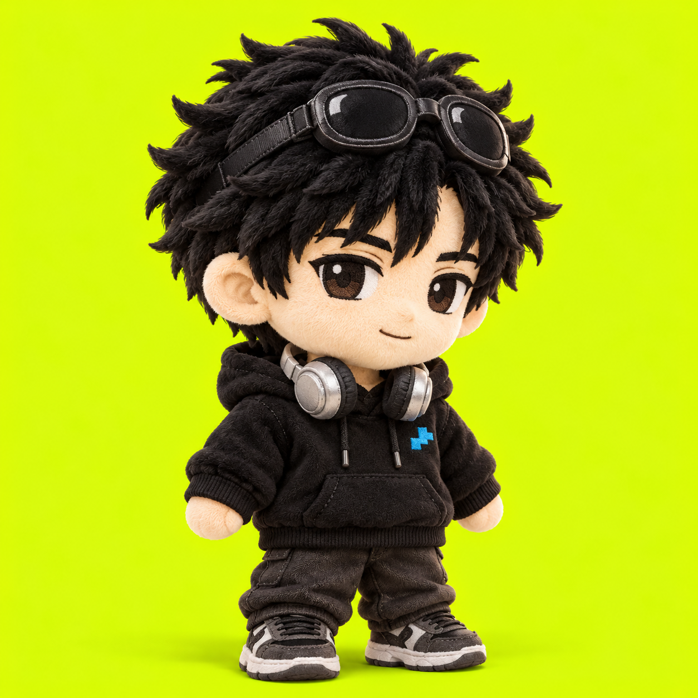

```text
使用 $lany-avatar，风格 plush，生成一只完整毛绒小生，保留布制护目镜、银灰耳机和蓝色小绣标。
```

### 10 · 扁平手绘漫画吉祥物（flat-comic）

漫画信息图的简洁角色基准。**漫画入驻探针，待确认**；背景：满版暖米白。

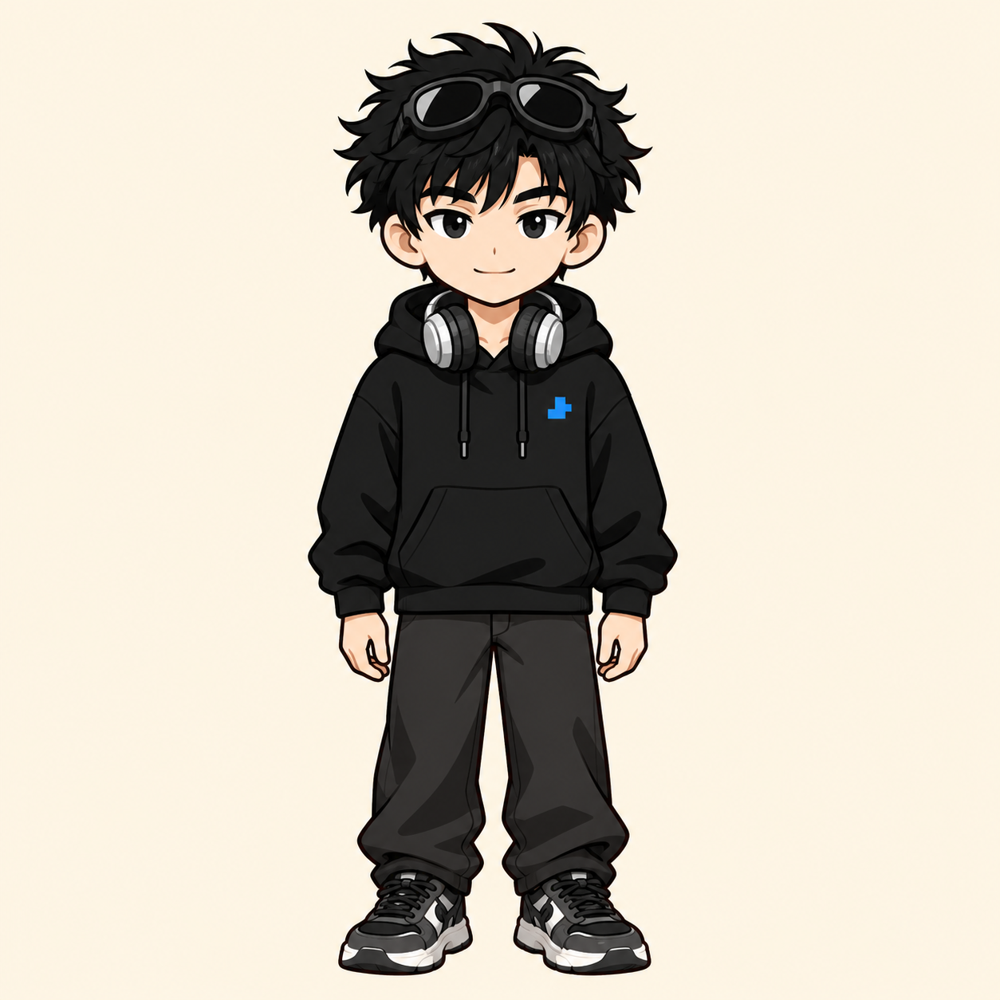

```text
使用 $lany-avatar，风格 flat-comic，只生成一张暖米白底的正面全身漫画确认图，不继续三视图或表情包。
```

## 追加：四种上半身头像（2026-10-26）

以下在原有十种风格基础上追加四张上半身候选，原图与原示例全部保留。新图均为原生返回的 **1254×1254 PNG**，没有插值放大；追加到 README 不表示替换原版本或选定新默认头像。

这里沿用稳定风格编号 **02、03、06、07**，不是给四张图片重新编号。配饰与衣服只是本次示例，不是某风格的强制配置。

### 追加 A · 自然手绘（02 / soft-handdrawn）

灰绿休闲外套、米白内搭，雾蓝灰满版背景；不戴墨镜和耳机，保留自然墨线与轻纸纹。自然手绘是默认媒介，**这张新样例仍是未选定候选**。

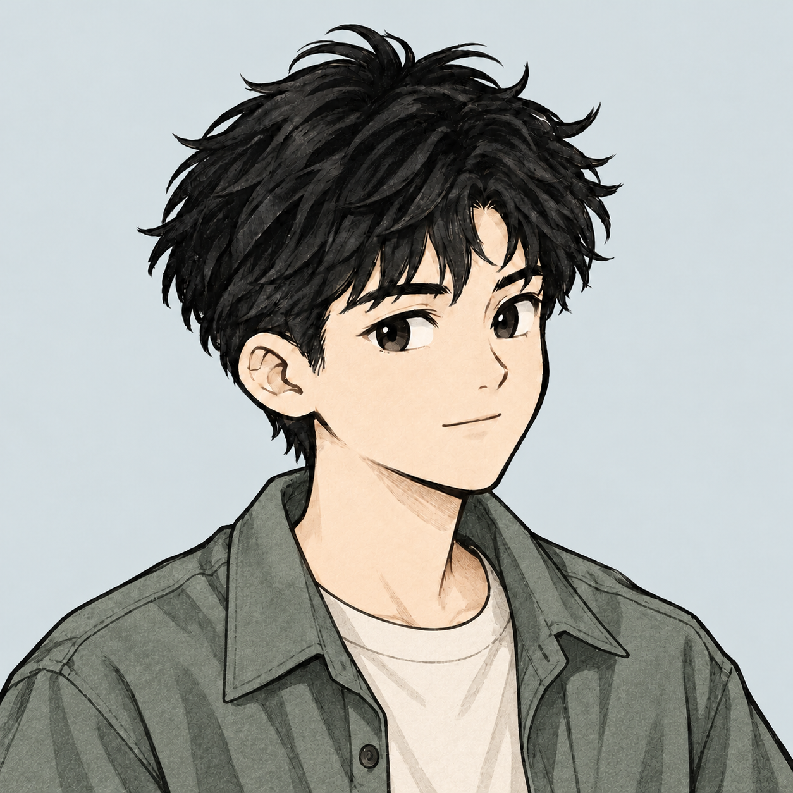

[原图](assets/upperbody/soft-handdrawn.png) · [示例提示词](references/upperbody-examples.md#soft-handdrawn)

```text
使用 $lany-avatar，风格 soft-handdrawn，做一张自然手绘上半身头像，雾蓝灰满版背景，自然闭口浅笑，不加腮红。
```

### 追加 B · 赛璐璐动漫（03 / cel-anime）

黑色卫衣与颈挂耳机，主题黄绿满版背景；去掉头顶眼镜，使用清楚轮廓与两级阴影。耳机是本次选择，可以按请求移除。

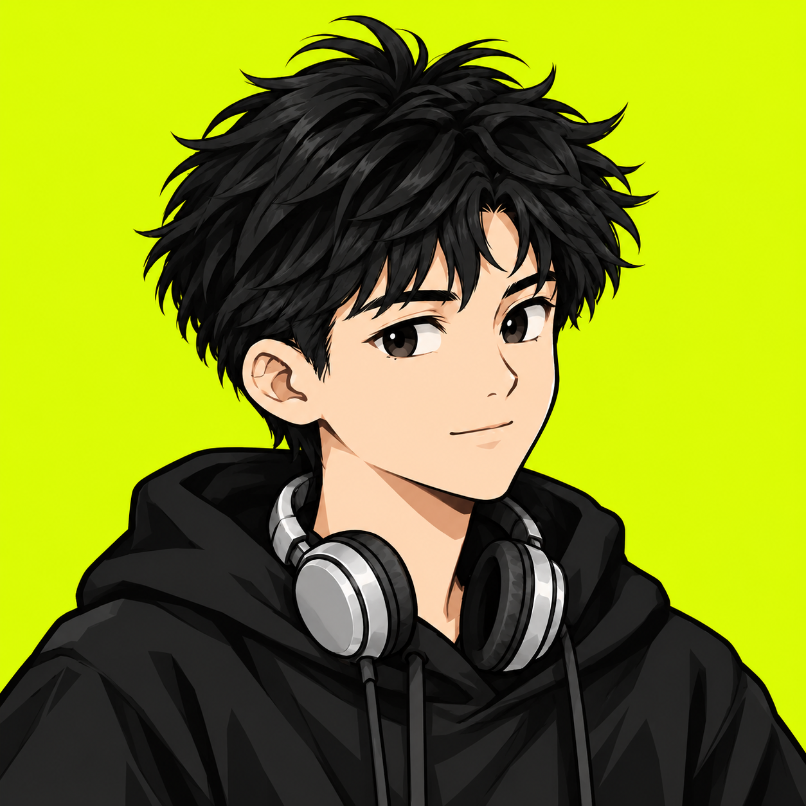

[原图](assets/upperbody/cel-anime.png) · [示例提示词](references/upperbody-examples.md#cel-anime)

```text
使用 $lany-avatar，风格 cel-anime，做一张赛璐璐上半身头像，黑色卫衣，不戴头顶墨镜，耳机按本次需要选择。
```

### 追加 C · 温暖动画 3D（06 / storybook-3d）

米白休闲衬衫、浅灰内搭，不戴墨镜或耳机。相对简洁 3D，保留更多有机发束、柔和光线与棉布细节；不延伸成全身公仔。

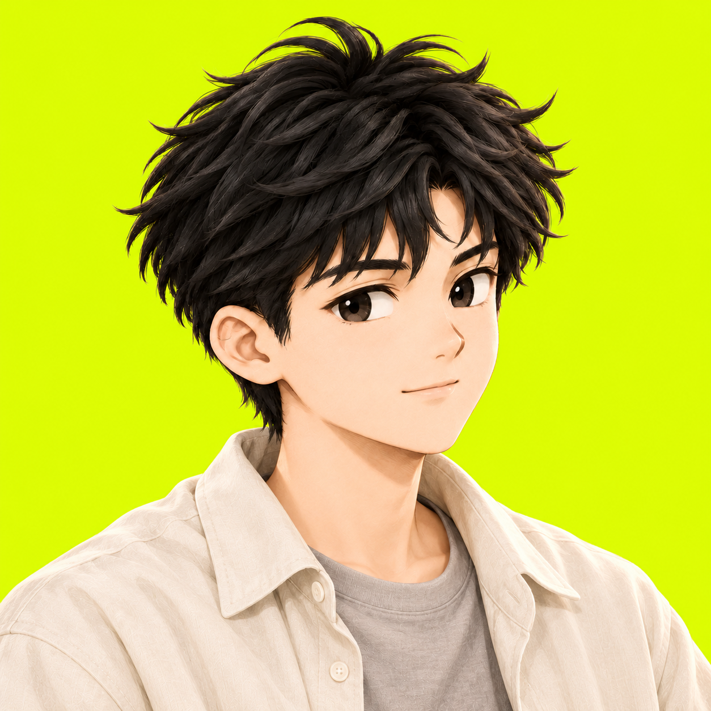

[原图](assets/upperbody/storybook-3d.png) · [示例提示词](references/upperbody-examples.md#storybook-3d)

```text
使用 $lany-avatar，风格 storybook-3d，只做完整头顶到胸口的头像，柔和光线、中性浅米肤色，不戴墨镜和耳机。
```

### 追加 D · 简洁 3D（07 / emoji-3d）

炭灰圆领卫衣，柔和哑光材质与较收简的立体发束；不戴配饰、不挥手、不合十。动作不是该风格的固定要求。

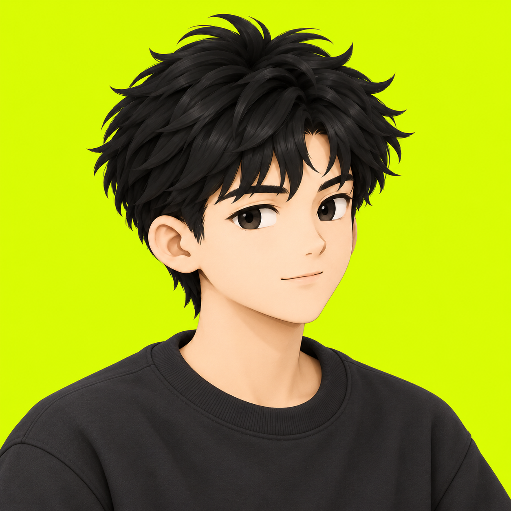

[原图](assets/upperbody/emoji-3d.png) · [示例提示词](references/upperbody-examples.md#emoji-3d)

```text
使用 $lany-avatar，风格 emoji-3d，做一张简洁三维上半身头像，炭灰圆领卫衣，睁眼自然浅笑，不画手和道具。
```

## 完整风格索引（原版＋追加版）

| 编号 | 风格 ID | 用途 / 状态 |
| --- | --- | --- |
| 01 | [pixel](references/style-catalog.md#pixel) | 像素兼容，仅明确选择 |
| 02 | [soft-handdrawn](references/style-catalog.md#soft-handdrawn) | 默认媒介；上方新样例未选定 |
| 03 | [cel-anime](references/style-catalog.md#cel-anime) | 赛璐璐上半身候选 |
| 04 | [designer-vinyl](references/style-catalog.md#designer-vinyl) | 潮玩质感旧头像候选 |
| 05 | [screenprint](references/style-catalog.md#screenprint) | 丝网印刷旧头像候选 |
| 06 | [storybook-3d](references/style-catalog.md#storybook-3d) | 温暖动画 3D 上半身候选 |
| 07 | [emoji-3d](references/style-catalog.md#emoji-3d) | 简洁 3D 上半身候选 |
| 08 | [photo-style](references/style-catalog.md#photo-style) | 虚构角色真人化，不是本人照片 |
| 09 | [plush](references/style-catalog.md#plush) | 毛绒媒介；头像仍默认上半身 |
| 10 | [flat-comic](references/style-catalog.md#flat-comic) | 简约漫画媒介；不自动进入全身建档 |

原版图文完整展示在前面的“原有风格画廊”，不折叠、不只保留链接。新增四图是同一风格下的追加样例；可明确选择原版或追加版，未选择时不将旧图删除或升级候选为默认。

## 身份、配饰与候选状态

- 默认身份参考仍是 [原自然手绘头像](assets/lany-avatar-handdrawn-reference.png)，不是上方新候选；用户本轮明确提供或确认的身份图优先。
- 固定脸型、五官关系、黑色短发、年龄感与气质。穿搭、墨镜、耳机、手势和道具按需求变化，不靠强制配饰维持身份。
- 只改肤色等局部细节时，保留未要求变化的表情、服装和配饰；需要换装时再改变它们。
- 只有明确要求更换默认资源，才在备份后替换指定文件。更新文档或加入画廊不代表改账号头像、自动发布或推送远程。

## 安装与文件结构

独立仓库为 [LanyXiaosheng/lany-avatar-skill](https://github.com/LanyXiaosheng/lany-avatar-skill)，仓库根目录就是技能目录，技能名称仍为 `lany-avatar`。从独立仓库安装时可发送：

```text
使用 $skill-installer，从 https://github.com/LanyXiaosheng/lany-avatar-skill 的 master 分支安装仓库根目录技能，安装名称使用 lany-avatar。
```

按安装器返回的说明完成加载。已有同名技能先备份和对比，不静默覆盖个人改动；不能只复制 README 而遗漏图片，也不要把仓库的 `.git` 复制进安装目录。

```text
lany-avatar/
├── SKILL.md                         精简运行入口与任务边界
├── README.md                        人类可读画廊与调用示例
├── agents/openai.yaml               显示信息与默认调用提示
├── references/
│   ├── style-dna.md                 身份、构图和候选规则
│   ├── style-catalog.md             稳定风格编号与媒介差异
│   └── upperbody-examples.md        四种上半身示例提示词
└── assets/
    ├── lany-avatar-handdrawn-reference.png
    ├── lany-avatar-reference.png
    ├── upperbody/                  四张当前上半身候选
    └── styles/                     原有历史媒介样例
```

## 验收与限制

四张新图已在任务中检查完整方图、圆裁及 48px／96px 预览；脸和眼神可辨，但媒介转换不是五官像素级一致性保证，部分发梢圆裁时可能贴边。报告实际尺寸，不把请求尺寸或放大尺寸当成原生分辨率。

正式全身、三视图和动作包只在未来另有明确请求时处理；本轮不继续。写真不等于本人照片，毛绒或潮玩渲染不等于已制造实物。本包完整保留 10 个风格 ID、12 张原资源及原有图文展示，再追加 4 张上半身候选，共 16 张 PNG。
